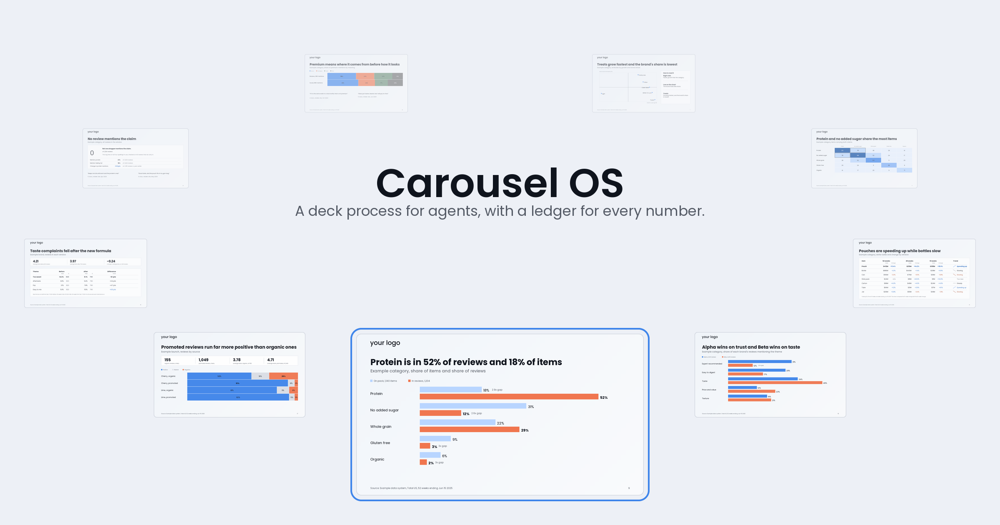

# Carousel OS

[](https://www.npmjs.com/package/carousel-os) [](https://github.com/briangrover9-hue/carousel-os/actions/workflows/check.yml) [](LICENSE)


*Slides drawn by the author's own engine, which is not included.*

An agent process for building slide decks you can defend. It interviews you, storyboards and critiques the plan before any slide exists, traces every number to its source, and has a reviewer that didn't build the deck sign off. Includes a blueprint for your own design system, engine and agent team. Works in Claude Code, Cursor and Codex.

## Install

Run this in a terminal, pointing it at the folder where you make decks:

```
npx carousel-os init path/to/your-project
```

Then open that project in Claude Code, Cursor or Codex and start your first deck with `carousel-start` (in Claude Code, type `/carousel-start`). It needs Node 20 or newer. The package is on [npm](https://www.npmjs.com/package/carousel-os), and everything it installs is listed under [Getting started](#getting-started).

Every slide gets one ledger entry, and every number printed on the slide is listed in it with its source, its window and a check that has to pass before the entry counts. A script then reads the slide text out of the deck file and compares it with the ledger.

I built a deck by hand, swore I would never do it that way again, and turned the habits I had picked up into this process.

## Moments it is built for

You tell the agent a number is wrong. It says it is fixed, and it is not. In Carousel OS an entry becomes `checked` only after someone recomputes the number from its source and writes down what they did, and a script opens the .pptx and compares the printed slide with the ledger.

A slide carries a figure nobody can trace. Every number sits in the ledger with its source and window, and a number on a slide that the ledger lacks fails the check.

The check passes and the mistake is still there. A reviewer starts with fresh context, sees only the bar and the files, and tries to disprove the deck. It pastes the value it found for every number.

You tell it the same thing for the third time. Each correction becomes a dated lesson, and a lesson corrected twice becomes a rule after you approve it.

It looked done until someone else read it. Before anyone else sees it, the headlines read alone have to make the argument, and a fresh reviewer has to fail to break it.

## Who it is for

People who ship decks with numbers in them: analysts, consultants, product and strategy leads, anyone who presents a readout to readers who will ask where a figure came from. It runs inside an agent such as Cursor, Codex or Claude Code and needs Node 20 or newer.

## Two ways to use it

- **You have a deck due.** Install the process as it ships and let it carry one deck from brief to review.
- **You run a team.** Treat the process as the backbone and build your own pieces around it: your brand as a design system in code, an engine, the questions your team keeps getting asked, and connectors to your data. [Build your engine](docs/build-your-engine/README.md) and [the agent system](docs/build-your-engine/agent-system.md) are the blueprint, and the two reviewer agents in `agents/` are working examples to copy.

## What you get

- A finished, checked deck in PowerPoint or Google Slides.
- A claim ledger for it: one entry per slide, each number in it with its source and window, each entry marked checked only after someone recomputed it.
- A plan file that records every stage, so you can read how the deck got made.
- A memory that carries your corrections from one deck to the next.

## Getting started

```
npx carousel-os init path/to/your-project
```

Or from a clone:

```
git clone https://github.com/briangrover9-hue/carousel-os.git
cd carousel-os
node scripts/install.js init path/to/your-project
```

In a clone, `node scripts/check-process.js --plan plans/example/wrenmoor-skip-cancel.md` shows a passing deck. It prints `PASS plan`.

The installer copies the process into your project and leaves any file you already have alone. Open the project in your agent and run `carousel-start`. Two more commands keep it healthy:

- `npx carousel-os doctor path/to/your-project` lists anything missing.
- `npx carousel-os update path/to/your-project` brings a newer version across without touching files you edited. Anything it has to replace is saved as a `.carousel-backup` first.

From a clone, the same commands are `node scripts/install.js doctor` and `node scripts/install.js update`. The copy of the installer inside your project refuses to run, so it can never mistake your own files for the tool's.

## How it works

You type nine commands, one at a time. No command starts the next, and each declines to run until the previous stage's report line is in the plan.

1. `carousel-start` reads what the last session left and opens a plan.
2. `carousel-brief` interviews you. It is the only stage that asks questions.
3. `carousel-storyboard` writes one headline, claim and source per slide, and opens the ledger.
4. `carousel-critique` attacks the plan from a new angle, three rounds on the full path.
5. `carousel-build` builds the deck and checks each ledger row as its slide is finished.
6. `carousel-check` reads the deck file, runs any engine you registered, and pastes exact results.
7. `carousel-review` hands the deck to two reviewers with fresh context who try to disprove it.
8. `carousel-wrap` runs one more check, logs the session and records lessons.
9. `carousel-handoff` writes the note the next session starts from.

A single prompt would interpret the request, pick the story, find the numbers, draw the slides and grade itself in one pass, so its mistakes go into the deck with its own approval. [How it thinks](docs/how-it-thinks.md) explains what each piece of the process targets. A short internal deck can take the [short run](docs/short-run.md): the same nine stages with one critique round.

## A rejection, a fix and a pass

The [worked example](plans/example/wrenmoor-skip-cancel.md) is about an invented gym chain. Its deck is a plain text deck built without an engine, so it shows the process and has no design to judge. The first review rejected it. This is the reviewer's finding, copied from the plan:

> s03 31.2%: recomputed from cancellations.csv and visits.csv, found 31.2%. The slide printed 31%. MISMATCH.
> Finding: s03 printed 31% where the source and the ledger say 31.2%. One unreconciled number.

The fix pass changed slide 3 to print 31.2%, the ledger's value. A new check ran, a second review recomputed every number, and it passed. The critique rounds had already caught a survey percentage divided by the wrong base: 300 of the 1,428 members who answered, not of all 4,200 cancellations. Here are the report lines from that run:

```
Start report: plan plans/example/wrenmoor-skip-cancel.md created; path full; handoff read; lessons loaded 0.
Brief report: 6 questions asked, 6 answers recorded, 0 ASK markers open.
Storyboard report: 6 slides, headlines-only read holds, ledger rows 6.
Critique round 1 of 3: angle Literal ask (new). Fixed 1; waiting 1; verified 1; ledger rows open 0.
Critique round 2 of 3: angle The unreconcilable number (new). Fixed 2; waiting 0; verified 1; ledger rows open 1.
Critique round 3 of 3: angle Open rows (new). Fixed 1; waiting 0; verified 1; ledger rows open 0.
Build report: 6 slides built, 6 ledger rows checked, 2 calls logged.
Check report: path rubric; plan PASS; ledger PASS; tools none; checklist 9 of 9; Waiting on you: item 9, no render available.
Review verdict: REJECT; unreconciled numbers 1; findings 1.
Build report: 6 slides built, 6 ledger rows checked, 2 calls logged.
Check report: path rubric; plan PASS; ledger PASS; tools none; checklist 9 of 9; Waiting on you: item 9, no render available.
Review verdict: PASS; unreconciled numbers 0; findings 0.
Wrap report: check PASS; log entry written; lessons added 1; wiki pages touched 1; entries rotated 0.
Handoff report: memory/handoff.md written; 2 bullets; focus confirm whether the exit survey was voluntary.
```

## What the check says when a number is wrong

I copied the example to a temporary folder, changed slide 3 in the deck file to print 31% and ran the plan gate. This is the real output:

```
$ node scripts/check-process.js --plan plans/example/wrenmoor-skip-cancel.md
Plan: the deck read against 6 ledger rows and the Build table
  the deck changed after Build recorded its hash. A changed deck needs a new Build.
  slide s03: ledger number "31.2%" is not printed in the deck (slide 3)
  slide s03: the deck prints 31, which is not in the ledger
  slide s03: the deck prints 31 but the Build table does not
  slide s03: the Build table shows 31.2 but the deck does not print it
FAIL plan (5)
```

The exit code is 1, and the Check stage reports `plan FAIL` until a new Build fixes the slide.

## Evidence you can read

- [The plan](plans/example/wrenmoor-skip-cancel.md) holds the brief, storyboard, three critique rounds with their change lists, the pasted check output and the reviewer's evidence.
- [The ledger](plans/example/wrenmoor-skip-cancel.ledger.json) holds 16 numbers across 6 slides, each with its source and the check that confirmed it.
- `node scripts/check-process.js` reads that plan as a state machine and opens the deck file. It fails when a report line is out of order or a printed number is missing from the ledger. It also fails when a deck changes after its check, or when a review passes without pasted evidence. `node tests/process/run.js` holds the broken variants it must reject, including a plan that passed every stage without doing the work.

## Bring your own engine

An engine is a program that draws slides, checks them, or both. It might be a scanner that counts type sizes and colors, a renderer that turns the deck into images, or a drawing kit that refuses what it cannot draw well. Carousel OS does not ship one. It ships the process and a blueprint, and it works without an engine, using a written checklist instead.

You can build your own, or plug in one you already have. Register it in `carousel.config.json`, and `carousel-check` runs it and records what it says. The sample is [carousel.config.example.json](carousel.config.example.json), and [the engine contract](bookshelf/engine-contract.md) defines the keys and exit codes.

- [Build your engine](docs/build-your-engine/README.md) says what a good engine checks and in what order to build it.
- [The gallery](https://github.com/briangrover9-hue/carousel-os/tree/main/docs/gallery) shows slides drawn by the author's own engine. The engine is not included.

## Time and tokens

The full run is slow and uses many tokens. The review costs the most because the reviewer re-reads everything with no shared context. [Time and tokens](docs/cost.md) says where the tokens go and what you can trim. I have not measured what trimming saves. Run targeted checks while you work, then one complete check at the check stage and another at wrap.

## Limits

- The agent still does the thinking and the storytelling. The process makes its work visible and checkable, and you remain the person who decides.
- The checks catch what they were built to catch. A deck can pass every one and still be dull or wrong in a way none of them anticipated, so read it before it leaves.
- The plan gate reads the text in a .pptx file and the values inside native charts. It does not read text inside images, charts drawn as pictures or speaker notes.
- Without an engine, the check is a written checklist that the agent answers, which is weaker than a program that counts.
- The targets are PowerPoint and Google Slides. For Slides, export a .pptx before the check.

## Cursor, Codex and Claude Code

Each stage is a skill with one source file, `.agents/skills/<stage>/SKILL.md`, and the installer puts it where each tool looks.

- **Codex and Cursor** use `.agents/skills/` in your project as-is: it is the source. Type the stage name, such as `carousel-start`, or pick it from the skills list.
- **Claude Code** reads `.claude/skills/`, where `scripts/generate-skills.js` and the installer mirror each stage. Type `/carousel-start`. The two reviewer agents go to `.claude/agents/`, and `carousel-review` starts them.
- **Any other agent** can read the same `SKILL.md` files as plain instructions, and the reviewers in `agents/` as plain prompts.

Every stage is manual-only. None of the three tools will start one on its own, because the process waits for you between stages. `AGENTS.md` (read by Cursor and Codex) and `CLAUDE.md` (read by Claude Code) both point the agent to `RULES.md`, which holds the rules and the order of the stages. Pass `--no-agents` to skip the `.claude/` copies.

## Changing Carousel OS

One rule has one owner: `RULES.md` owns rules, each stage file owns its procedure, each bookshelf page owns its reference. Change a rule in one place. Edit a stage in `.agents/skills/` and run `node scripts/generate-skills.js` to refresh its copies. Then run `node scripts/check-process.js` and `node tests/process/run.js`. The first checks the byte budgets, links, the wiki index, the report formats, the plan state machine, the deck file against the ledger, the prose and spelling rules, and your log, lessons and ledgers. The second proves each of those checks can fail.

## License

MIT. See the LICENSE file.

## Reference

**Stages**: [.agents/skills/README.md](.agents/skills/README.md) lists the nine stages and what each does.

**Reviewer agents**

- **[carousel-reviewer](agents/carousel-reviewer.md)**: tries to disprove the deck against the bar.
- **[carousel-fidelity](agents/carousel-fidelity.md)**: recomputes every number on the slides from the ledger's sources.

**Bookshelf**

- **[ask-first](bookshelf/ask-first.md)**: the brief's questions in order, and the default for each gap.
- **[lessons](bookshelf/lessons.md)**: how corrections become lessons and rules, and who decides.
- **[claim-ledger](bookshelf/claim-ledger.md)**: the ledger's fields, the rule for `checked`, the final gate.
- **[review-angles](bookshelf/review-angles.md)**: the master list of critique angles for decks.
- **[engine-contract](bookshelf/engine-contract.md)**: the config file and exit codes for plugging in your own engine.
- **[rubric](bookshelf/rubric.md)**: review dimensions, floors, caps, and what P0 and P1 mean.
- **[preflight](bookshelf/preflight.md)**: the checklist by section and the anti-tells.
- **[design](bookshelf/design.md)**: the taste layer behind what gets drawn.
- **[writing](bookshelf/writing.md)**: the writing standard for slide text.
- **[narrative-devices](bookshelf/narrative-devices.md)**: named slide beats for the storyboard.

Also: [RULES.md](RULES.md), [CHANGELOG.md](CHANGELOG.md), [cheatsheet.md](cheatsheet.md), [bookshelf index](bookshelf/README.md), [short run](docs/short-run.md), [cost](docs/cost.md).

## Author

Carousel OS is built and maintained by Brian Grover.

- LinkedIn: [linkedin.com/in/briantgrover](https://www.linkedin.com/in/briantgrover/)
- GitHub: [github.com/briangrover9-hue](https://github.com/briangrover9-hue)
- Email: briangrover9@gmail.com
