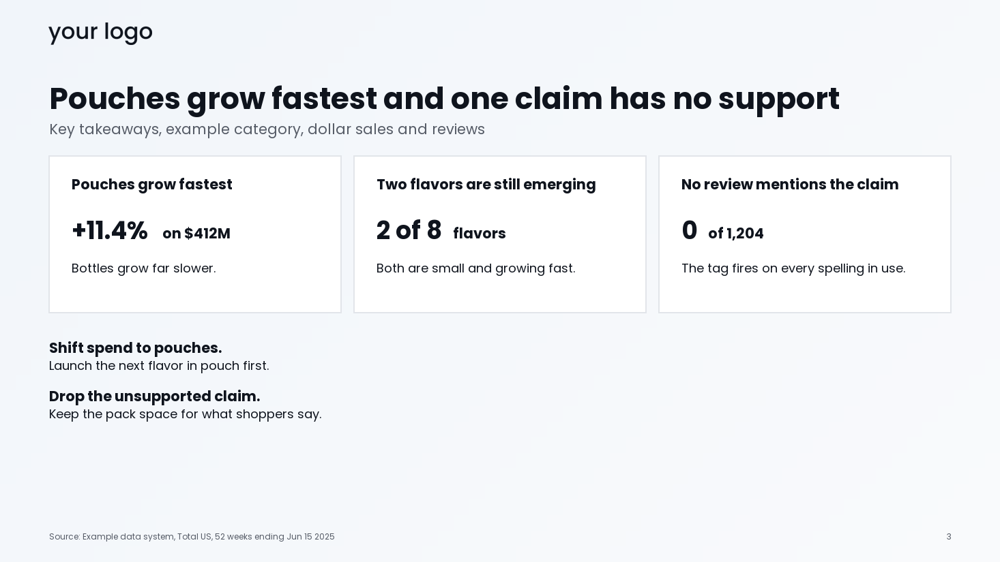
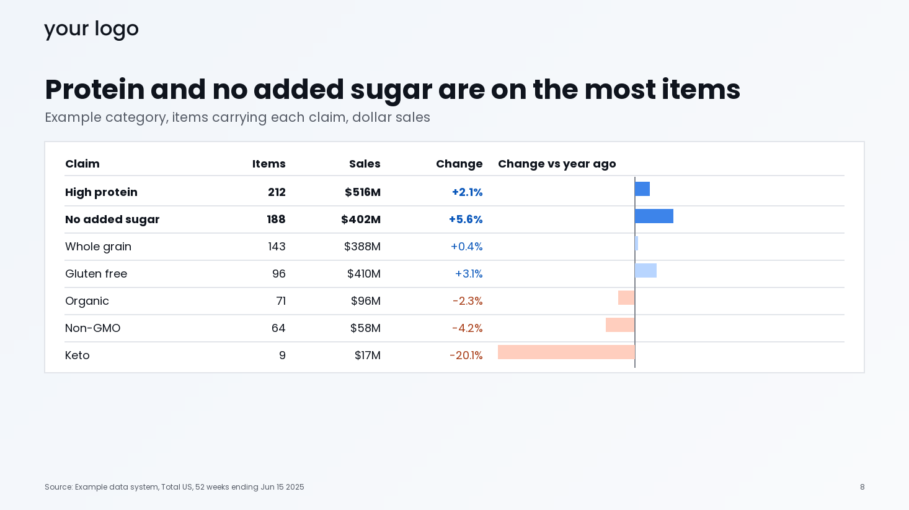
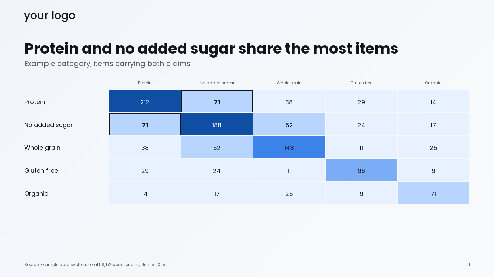
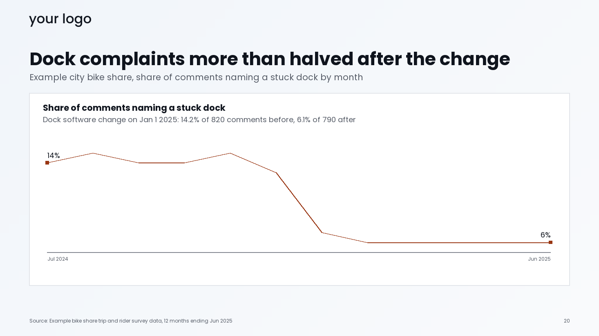
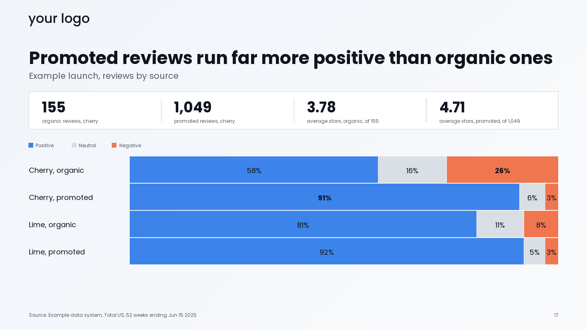
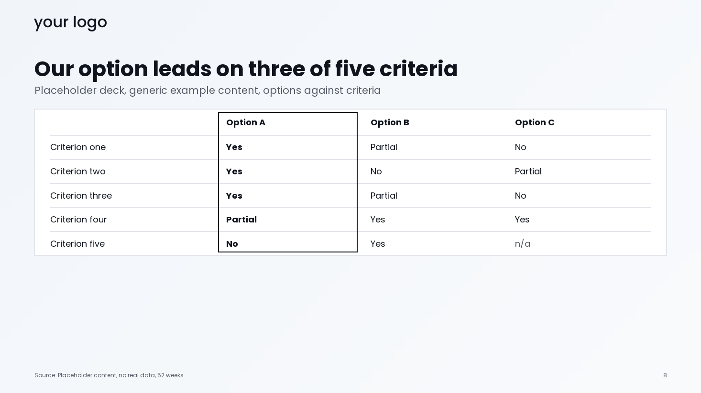
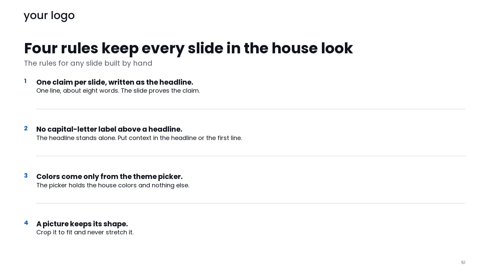

# Gallery

Eight slides from decks the author's own engine drew. That engine is not part of this repo: Carousel OS ships the process and a blueprint for building your own, and these images show the kind of output the process can check. Every slide holds placeholder data and invented names.

Three stat cards, each with a headline number, its unit and one plain reading, above a short list of actions.

A ranked bar table: seven claims sorted by item count from most to fewest, with sales, the change and a signed bar for the change, and a printed value on every row.

A heatmap of how often two claims appear on the same item. The column headings match the row labels, there are five fixed shades of one blue, and every cell prints its number.

A line chart of one rate by month. The card names the dated change and gives both periods with their counts, and only the first and last points carry a printed value.

A share bar of positive, neutral and negative reviews for four groups, with a band of totals above it. Every segment prints its value.

Praise and complaints mirrored around a label column, with two verbatim quotes and their sources on the right.

Three options against five criteria in a plain table, one short answer per cell.

A slide from the master template: a headline, a scope line and a numbered list of four rules. It shows no data, so it carries no source line.
